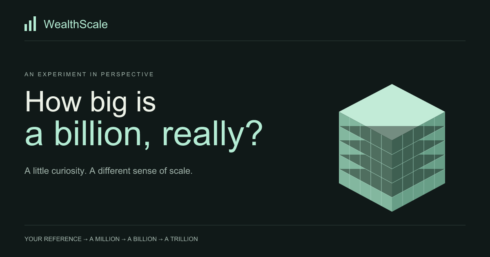

# WealthScale

An interactive experiment in perspective: start with a familiar amount, build a million and a billion, meet a real fortune, and explore a hypothetical trillion.

<p align="center">
  <a href="https://wealth-scale.vercel.app/">
    
  </a>
</p>

<p align="center">
  <a href="https://wealth-scale.vercel.app/">Open the live exhibition</a>
  ·
  <a href="https://github.com/MediaChronicle/WealthScale">View the source</a>
</p>

## Run locally

Use Node 24 (see `.node-version`) and pnpm 12.4.2 (pinned in `packageManager`).

```sh
pnpm install --frozen-lockfile
pnpm dev
pnpm preflight
```

`pnpm preflight` runs TypeScript, ESLint, formatting, tests, and a production build. `pnpm preview` serves the build; `pnpm build:analyze` writes `dist/bundle-report.html`. `pnpm brand:build` regenerates PNG brand assets from the SVG sources.

Read [CONTRIBUTING.md](CONTRIBUTING.md) before submitting changes and
[SECURITY.md](SECURITY.md) before reporting a security issue. The repository
source uses the [MIT license](LICENSE). External wealth estimates and third-party
assets retain their own terms.

## Experience

- Six guided chapters, including a prediction before revealing 1,000 million-dollar blocks.
- Separate net worth and annual income comparisons, with explicit assumptions.
- A scale lab with proportional cube volumes, a reference cube, separation, orbit/zoom/reset, and an illustrated alternative.
- Cosmos, Towers, Ocean, and Timeline views of dated estimates, with one responsive inspector.
- Keyboard mode navigation and fortune selection, a five-round guessing game, reduced motion support, and local branded PNG export.
- New SVG mark, favicon, touch icon, and social preview.

The journey replaces the old dashboard as the entry point. The old earnings race, achievement toasts, and decorative particle/easter-egg effects were retired: they obscured the lesson and the race treated net worth as earnings. The four exploration concepts remain, rebuilt around bounded geometry and explicit scale legends.

## Data and accuracy

Forbes estimates are supplied by the public [RTB-API](https://github.com/komed3/rtb-api). Every real fortune shows the source date; this is not a live market feed. Zod validates responses before conversion from millions to dollars. Monthly history joins profile metadata to each month's list. Missing observations remain missing; values are never carried forward. Timeline follows the selected person through up to 12 months, using one maximum across the dataset. Gaps mean the person is absent from that month’s top ten, not that their wealth is zero.

Cube and sphere **volume**, tower **height**, and ocean **depth** encode dollars. Positions and camera framing are illustrative. Very small references can be subpixel; numeric comparisons remain available. The trillion is a hypothetical benchmark. Income comparisons assume every dollar is saved, without tax, spending, inflation, or investment returns.

Your reference stays in page memory. No account or personal-data upload is required. Exporting a scale-lab image includes the displayed reference when enabled; atlas exports include the selected fortune, not your personal amount.

## Architecture

One application at the workspace root; feature folders rather than unnecessary workspace packages:

```text
src/
  features/journey/     Guided lesson, reducer, scale mathematics, exhibit
  features/explorer/    Four worlds, inspector, guessing game
  features/comparison/  Shared reference input, validation, and insight
  features/shared/      Shared CSS shell and image-capture state
  api/                 Fetch boundary, schemas, snapshots, history, fixtures
  scene/lab/           Shared demand-rendered canvas and graphics policy
  hooks/               Responsive and reduced-motion preferences
```

React owns local interaction state. TanStack Query owns remote data. Both renderers consume validated dollar values. Three.js loads behind lazy graphics boundaries, renders on demand, and caps pixel density at 1.5 (1 for mobile/economy). The lab uses at most 1,000 instances; worlds show ten fortunes or a twelve-month trail. Million-dollar units retain their size through the billion reveal; later units explicitly regroup. Finite assembly and camera transitions settle back to idle. A matte floor receives bounded desktop shadows, disabled on mobile/economy. No post-processing, transmissive materials, or permanent screenshot buffer. Wheel and one-finger gestures scroll the page; use two fingers to orbit and buttons to zoom. Canvas does not remeasure on page scroll. WebGL2 is probed before mounting, and context restoration resumes the view. Initialization errors offer an illustrated fallback.

`pnpm-workspace.yaml` records release-age and build-script policies. Dependencies are upgraded within compatible ranges; React stays on 19.2 because Fiber 9.7 excludes React 19.3. Scene labels and a keyboard-accessible DOM key replace per-object accessibility roots. Plain CSS replaces unused Tailwind. CI repeats the frozen installation and preflight checks.

Above a billion and through a trillion, the lab uses fixed billion-dollar units and a fixed overview, with labelled million and billion anchors. The daily estimate request begins during the prediction chapter; missing and loading estimates remain distinct. Detailed implementation notes and review evidence live in the repository's local development plans rather than this public-facing overview.
